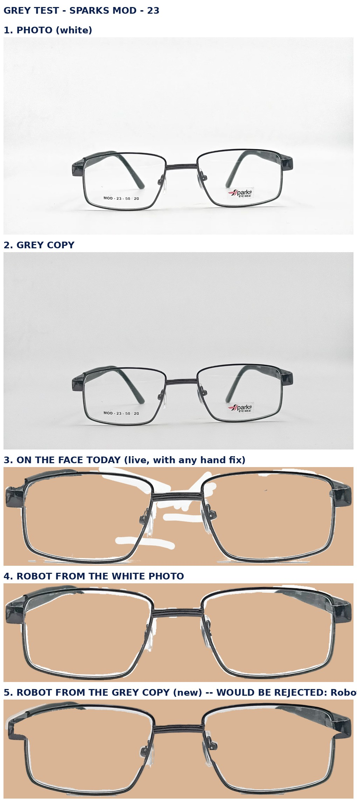
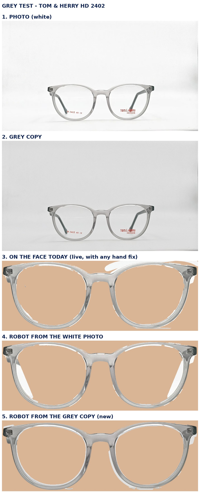
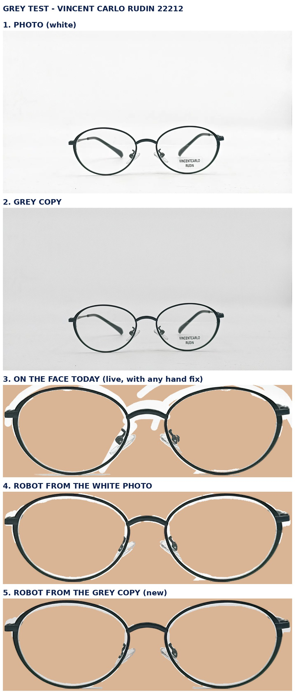

# Grey test

Run 9674, 27 Nov 2026 21:40 UTC. A test only: nothing was saved on any frame or on the shop.

Each picture: 1 the photo (white) / 2 its grey copy / 3 the try-on on the face TODAY / 4 the robot's cut from the WHITE photo / 5 the robot's cut from the GREY copy. 3, 4 and 5 are laid on skin colour, as on a face.

## SPARKS MOD - 23

Frame `pmwx60jct34`.

## TOM & HERRY HD 2402

Frame `pmwx72z0l91`.

## VINCENT CARLO RUDIN 22212

Frame `pmwvsni5a72`.

