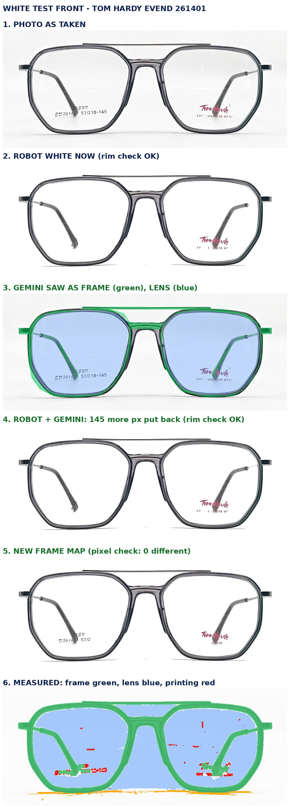
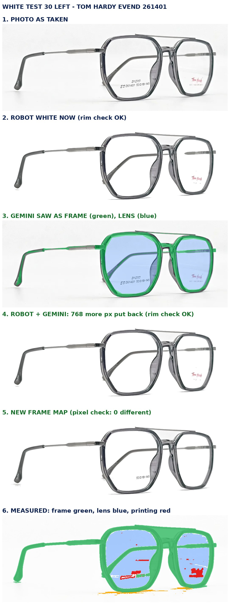
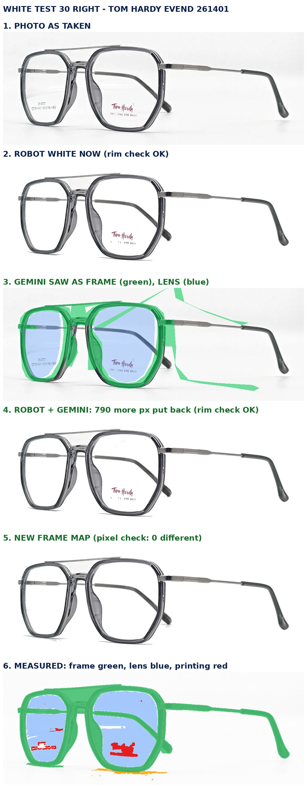

# White test: TOM HARDY EVEND 261401

Frame `pmwkdktb667` -- run 8274, 18 Nov 2026 06:44 UTC. A test only: nothing was saved on the frame or the shop.

Each picture: 1 the photo as taken / 2 the robot's white copy now / 3 what Gemini marked as frame (green) and as lens (blue) / 4 the robot's white copy with Gemini's help / 5 NEW: the frame map -- every frame pixel put back exactly as photographed, demo printing removed / 6 what the frame map measured.

## FRONT

Gemini: Gemini (gemini-3.8-flash) marked 7 part(s) as outline points [y,x] + the lenses; the lenses taken off the rims; parts: right rim, left rim, bridge, right hinge, left hinge, right arm, left arm

Frame map: frame map OK: 4 lens area(s), 67616 frame pixels measured, 4617 put back from the photo, pixel check 0 different, 2798 px of demo printing removed

[Open the FRONT picture in the photo store](https://res.cloudinary.com/jpf6kf5g/image/upload/v1794984124/wwcs61ink86kwrpyaw4s.jpg)

## 30 LEFT

Gemini: Gemini (gemini-3.8-flash) marked 7 part(s) as outline points [y,x] + the lenses; the lenses taken off the rims; parts: left rim, right rim, bridge, hinge, arm, hinge, arm

Frame map: frame map OK: 4 lens area(s), 73938 frame pixels measured, 4746 put back from the photo, pixel check 0 different, 4017 px of demo printing removed

[Open the 30 LEFT picture in the photo store](https://res.cloudinary.com/jpf6kf5g/image/upload/v1794984180/nessfhhgsg5ni3axbt5m.jpg)

## 30 RIGHT

Gemini: Gemini (gemini-3.8-flash) marked 9 part(s) as outline points + the lenses; the lenses taken off the rims; parts: left rim, right rim, bridge, left end piece, right end piece, arm, arm, nose pad, nose pad

Frame map: frame map OK: 4 lens area(s), 74302 frame pixels measured, 3760 put back from the photo, pixel check 0 different, 4554 px of demo printing removed

[Open the 30 RIGHT picture in the photo store](https://res.cloudinary.com/jpf6kf5g/image/upload/v1794984282/mpqkmt6o0ajkdmfcg3l4.jpg)

